# Atlas visual

Las ideas del proyecto, una por dibujo. Cada diagrama trae cómo leerlo, la idea en una frase y dónde se profundiza.

**Cómo usarlo**
- Mira el diagrama, lee "La idea" y, si quieres más, sigue el enlace.
- Para repasar, tapa "La idea" e intenta decirla tú.
- Los diagramas son Mermaid: se dibujan solos en GitHub, en VS Code (con la extensión *Markdown Preview Mermaid Support*) y en Notion (en un bloque de código con el lenguaje *Mermaid*).
- Las convenciones (cajas, cilindros, rombos, flechas punteadas) están en "Cómo leer los diagramas", al comienzo de `docs/GUIA.md`.
- Colores: **verde**, lo nuevo o lo permitido; **rojo**, un riesgo; **amarillo**, una reserva o algo provisorio.

---

## 1. Los diagramas que ya existen

| Idea | Tipo de diagrama | Dónde |
|---|---|---|
| El sistema y sus dos mundos, OT y TI | Flujo | `docs/COMO-ABORDAR.md`, sección 1 |
| El camino del dato | Flujo | `docs/COMO-ABORDAR.md`, sección 2.1 |
| La cadena de garantías | Flujo | `docs/COMO-ABORDAR.md`, sección 5 |
| La arquitectura completa | Flujo | `docs/GUIA.md`, sección 2 |
| El viaje de una lectura, paso a paso | Secuencia | `docs/GUIA.md`, sección 3 |
| El event loop de Node | Flujo | `docs/GUIA.md`, sección 5.1 |
| La cadena de middlewares de Express | Flujo | `docs/GUIA.md`, sección 5.2 |
| El login con JWT | Secuencia | `docs/GUIA.md`, sección 5.7 |
| Tópicos, QoS 1 y la sesión persistente | Flujo y dos secuencias | `docs/GUIA.md`, sección 5.8 |
| El upgrade del WebSocket | Secuencia | `docs/GUIA.md`, sección 5.11 |
| El flujo de Node-RED | Flujo | `docs/GUIA.md`, sección 5.12 |
| Imagen, contenedores y volúmenes | Flujo | `docs/GUIA.md`, sección 5.13 |
| El despliegue en Linux | Flujo | `docs/GUIA.md`, sección 5.14 |
| El flujo de Git de la Parte 1 | Git | `docs/GUIA.md`, sección 5.15 |
| El modelo de datos | Entidad-relación | `docs/GUIA.md`, sección 6 |
| La seguridad por capas | Flujo | `docs/GUIA.md`, sección 7 |
| Por qué no se pierden datos | Flujo | `docs/GUIA.md`, sección 8 |
| El detector de silencio | Estados | `docs/GUIA.md`, sección 10 |

---

## 2. Particiones: un cajón por mes

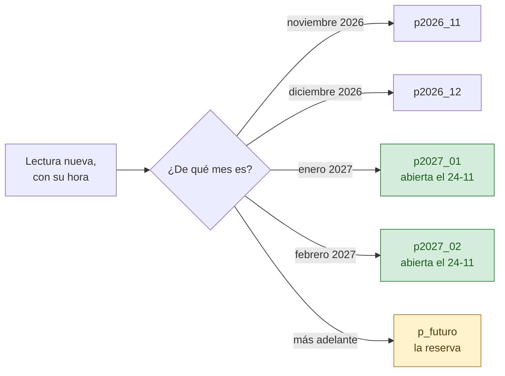

**Cómo leerlo.** La tabla `lecturas` es un archivador con un cajón por mes. MySQL mira la hora de cada lectura y la guarda en el cajón de su mes. Lo que llega después del último cajón cae en la reserva, `p_futuro`. En verde, los dos cajones que se abrieron el 24 de noviembre, cuando la reserva todavía estaba vacía.

**La idea.** Una reserva es una cuenta regresiva: los cajones se abren antes de que lleguen las lecturas de ese mes. Abrir uno vacío es instantáneo; partir una reserva con filas obliga a moverlas.

**Profundiza en:** `PLAN-2.md`, Fase 16, y `practica/rendimiento.sql`.

## 3. Borrar un mes: `DELETE` o soltar el cajón

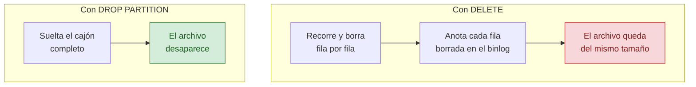

**Cómo leerlo.** Dos caminos para el mismo objetivo. El 16 de noviembre (Fase 11), borrar un mes de 2.422.937 filas con `DELETE` tardó 28,4 s, y soltar la partición, 3,9 s en Docker Desktop. En la prueba del caso 14, el `DELETE` de media partición tardó 6 s y el archivo siguió ocupando 88 MB; soltarla tardó 0,4 s y borró el archivo.

**La idea.** Para liberar espacio, se suelta el cajón; un `DELETE` masivo tarda, llena el binlog y no devuelve el espacio.

**Profundiza en:** `docs/rendimiento.md` y `docs/CRITERIO.md`, caso 14.

## 4. La deriva, y cómo se cierra

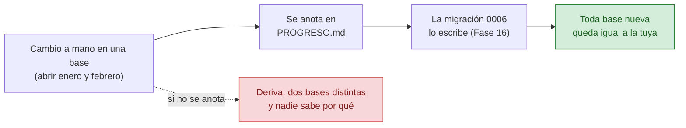

**Cómo leerlo.** El camino de arriba es el correcto: un cambio de emergencia se anota y después se formaliza. La flecha punteada es lo que pasa cuando no se anota.

**La idea.** Un cambio a mano es deriva hasta que una migración lo escribe.

**Profundiza en:** `PLAN-2.md`, Fase 16.

## 5. La misma versión en todas partes

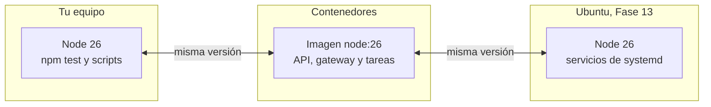

**Cómo leerlo.** Cada recuadro es un lugar donde corre tu código. La flecha doble dice que los dos extremos usan la misma versión de Node.

**La idea.** Si una prueba pasa en tu equipo, debe pasar en producción: es la paridad de entornos. Por eso `package.json` ahora exige Node 26 (`engines`).

**Profundiza en:** `PLAN-2.md`, Fase 25.

## 6. El servicio `tareas`: el reloj de la plataforma

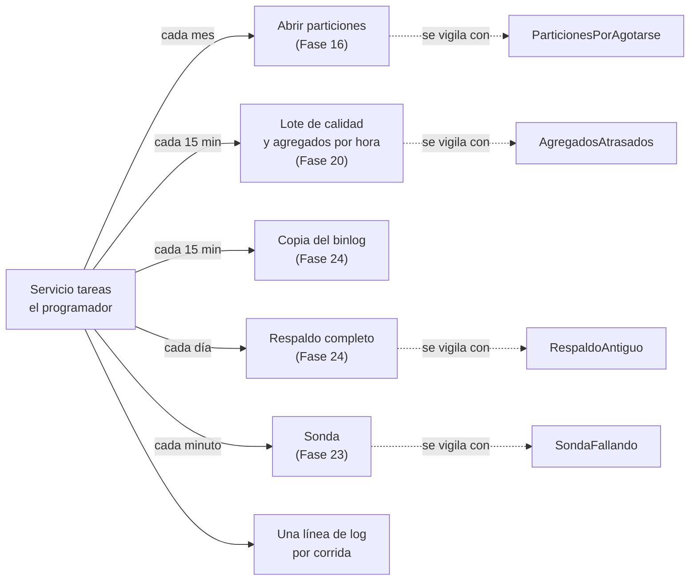

**Cómo leerlo.** Un solo servicio de Compose dispara todas las tareas periódicas, cada una con su frecuencia, y cada corrida deja una línea de log. Las flechas punteadas son las alertas de la Fase 23: no leen ese log, miran el efecto de la tarea (cuántos días de particiones quedan, la hora del último agregado, la edad del último respaldo, si la sonda informa). Así avisan tanto si la tarea falló como si nunca corrió.

**La idea.** En Windows no hay cron. Un servicio de Compose corre igual en tu equipo y en Linux, vive en Git y no superpone ejecuciones.

**Profundiza en:** `PLAN-2.md`, Fase 16, paso 6, y Fase 23 (las alertas).

## 7. La sonda y la alerta por ausencia

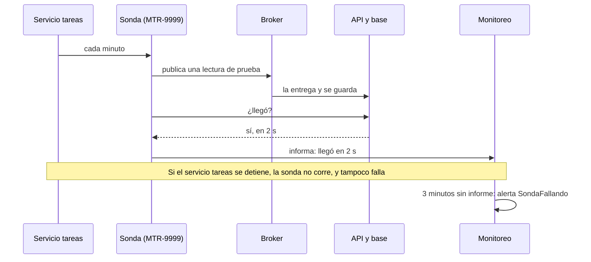

**Cómo leerlo.** Las columnas son los participantes, y el tiempo corre hacia abajo. La sonda se comporta como un equipo más: publica, y después comprueba que su dato llegó. La última línea es la clave: el monitoreo también alerta cuando la sonda deja de informar.

**La idea.** Algo que no corre no puede fallar. Por eso hay que alertar también por ausencia, no solo por error.

**Profundiza en:** `PLAN-2.md`, Fase 23, paso 4.

## 8. Permisos del broker: hoy y desde la Fase 27

**Hoy: un comodín por sitio**

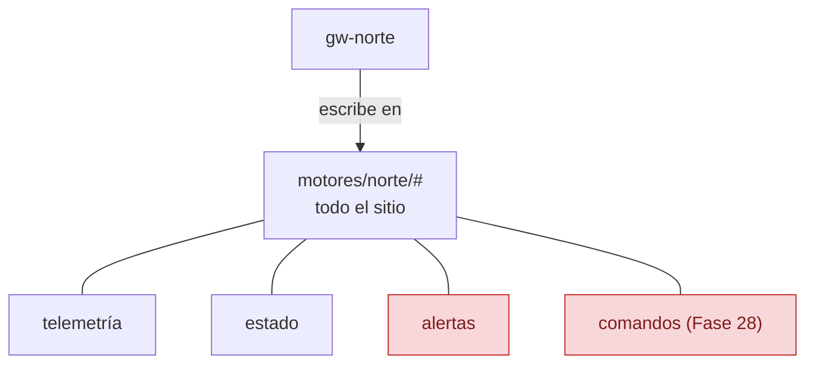

**Desde la Fase 27: un permiso por tipo de tópico**

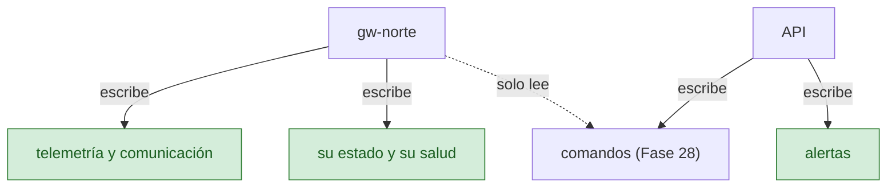

**Cómo leerlo.** El primer diagrama es el permiso de hoy: el gateway del sitio norte puede escribir en cualquier tópico del sitio, incluidas las alertas y, más adelante, los comandos (en rojo). El segundo es el de la Fase 27: cada gateway escribe solo lo suyo y solo lee sus comandos, y la API es la única que escribe alertas y comandos.

**La idea.** Permisos por puerta, no por edificio: si roban la credencial de un gateway, el daño queda acotado a lo que ese gateway necesita.

**Profundiza en:** `PLAN-2.md`, Fase 27, paso 5.

## 9. Las tres ausencias de un dato

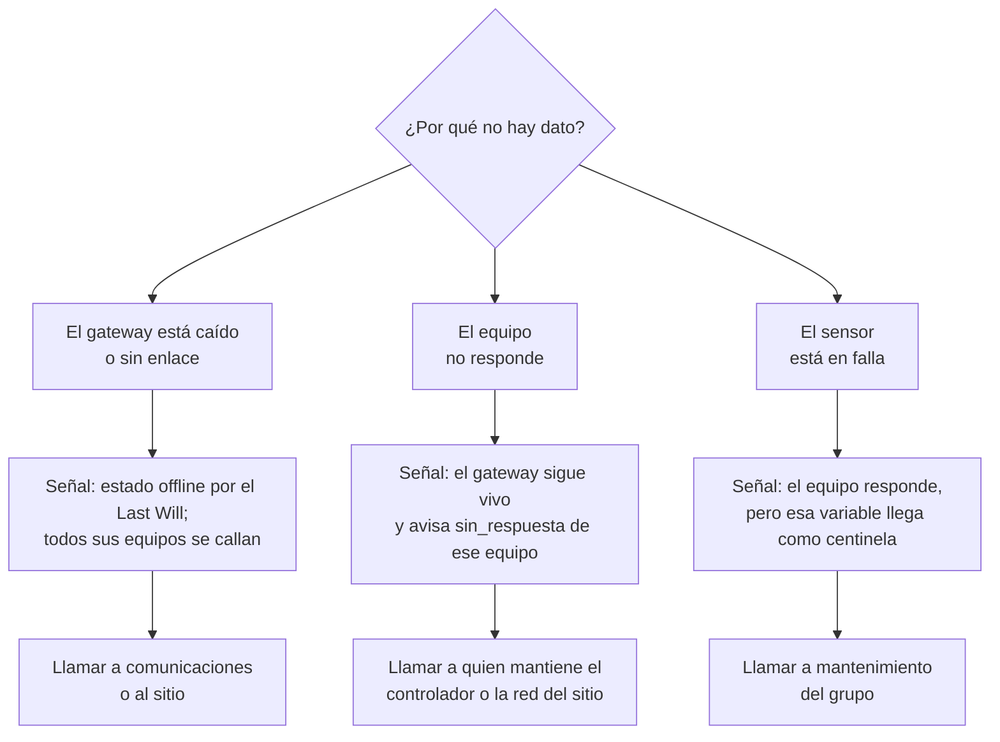

**Cómo leerlo.** Se lee de arriba hacia abajo: la causa, la señal que deja y a quién se llama. Cada columna es un caso distinto.

**La idea.** "Sin dato" no es una sola cosa: cada ausencia deja una señal distinta y la atiende una persona distinta.

**Profundiza en:** `docs/OT-TI.md`, sección 5, y `PLAN-2.md`, fases 18 y 19.

## 10. La escalera del dato

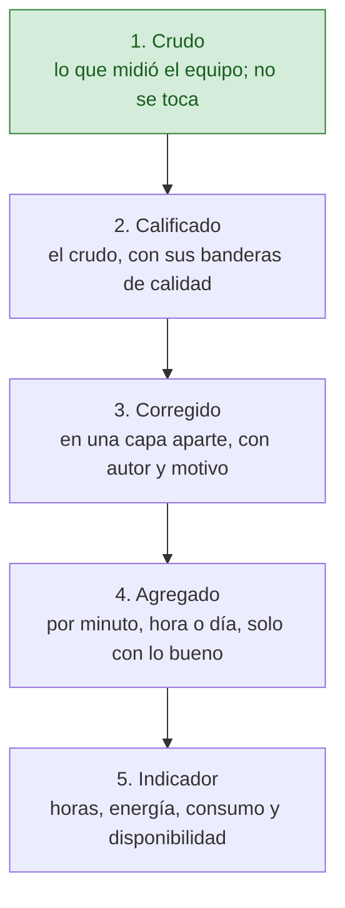

**Cómo leerlo.** Cada escalón se construye desde el anterior. El primero, en verde, es la base de todo.

**La idea.** Cada escalón se puede recalcular desde el de abajo. Por eso el crudo no se toca: si se daña, se cae toda la escalera.

**Profundiza en:** `docs/OT-TI.md`, sección 5, y `PLAN-2.md`, fases 19 a 21.

## 11. Cuántos puntos recibe un gráfico

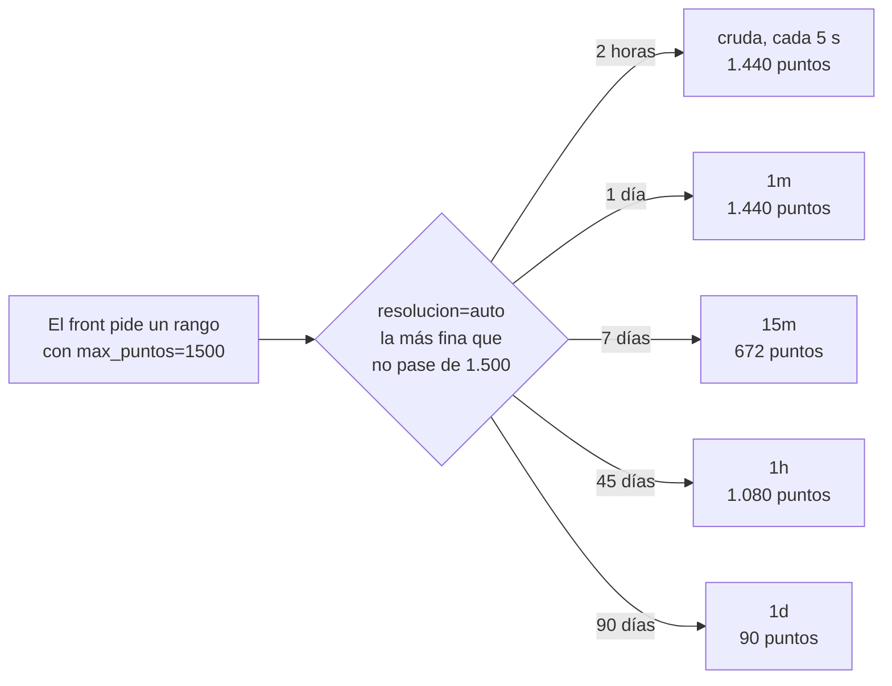

**Cómo leerlo.** A la izquierda, lo que pide el front. El rombo es la regla `auto`: prueba de la resolución más fina a la más gruesa y se queda con la primera que no pasa de 1.500 puntos. A la derecha, lo que recibe en cada caso. Un punto crudo trae el valor y su calidad; desde `1m`, cada punto es un resumen con promedio, mínimo y máximo, porque un promedio solo escondería los picos.

**La idea.** El servidor reduce y el front dibuja. En crudo, 7 días de una variable son unos 121.000 puntos y 90 días, más de 1,5 millones; un gráfico de 1.000 píxeles de ancho no puede mostrarlos.

**Profundiza en:** `PLAN-2.md`, Fase 22 (series con resolución).

## 12. El flujo de Git de la Parte 2

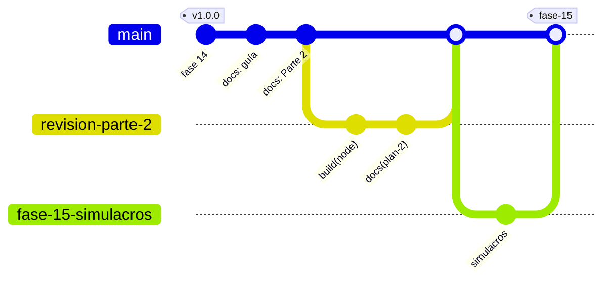

**Cómo leerlo.** Cada punto es un commit, cada línea es una rama y las uniones son merges, hechos con un PR. Las etiquetas son tags: versiones a las que se puede volver.

**La idea.** `main` siempre funciona: cada cambio se hace en su rama, se revisa y recién entonces entra.

**Profundiza en:** `docs/GUIA.md`, sección 5.15, y `PLAN-2.md`, Fase 25.

---

## 13. Cómo crece el atlas

Cada fase de la Parte 2 deja al menos un diagrama en su apunte y una entrada aquí, con cómo leerlo, la idea y dónde se profundiza.

**Un buen diagrama:**
- explica una sola idea;
- tiene unas 10 cajas como máximo;
- usa los colores de la leyenda, siempre con el mismo significado;
- trae "Cómo leerlo" debajo;
- se comprobó que se dibuja.
