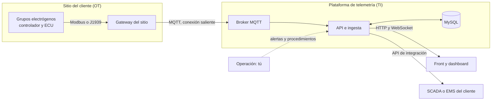
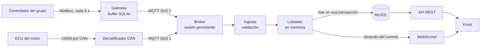
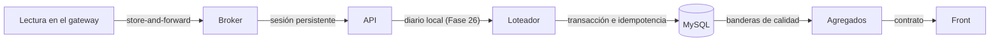

# Cómo leer y abordar este proyecto

Para ti y para cualquiera que reciba el proyecto. Se lee en unos 25 minutos; después sirve de mapa: vuelve a él cada vez que te sientas perdido.

**La idea en una línea.** Un proyecto de este tamaño no se lee de corrido: se recorre por niveles, como un plano eléctrico. Primero el unifilar general, después cada tablero y recién al final las borneras.

Hoy son dos planes (31 fases, de la 0 a la 30), unos 100 archivos, una docena de tecnologías y dos mundos, OT y TI. Si intentas entenderlo todo a la vez, no entiendes nada. Esta guía te da:
1. los cuatro niveles de zoom;
2. los cinco mapas que tienes que poder dibujar;
3. el orden para leer el código y las técnicas para hacerlo;
4. las preguntas que demuestran que dominas cada capa;
5. las 20 ideas que sostienen todo;
6. un sistema de estudio para avanzar sin ahogarte;
7. cómo aplicar lo mismo al sistema real de una empresa.

Para decidir rápido en una situación nueva está `docs/CRITERIO.md`. El índice de toda la documentación está en `docs/README.md`.

---

## 1. Los cuatro niveles de zoom

Es el modelo C4, que se usa para documentar arquitectura de software. Cada nivel responde una pregunta distinta.

| Nivel | Pregunta | En un plano eléctrico | En este proyecto | Dónde está |
|---|---|---|---|---|
| 1. Contexto | ¿Quién usa el sistema y con qué conversa? | El unifilar general | Grupos electrógenos, gateways, front, SCADA o EMS del cliente, operación | El diagrama de abajo y `docs/GUIA.md` §1 |
| 2. Contenedores | ¿Qué programas corren y cómo se hablan? | Los tableros y sus alimentadores | Gateway, broker, API, MySQL, dashboard, Node-RED | `docker-compose.yml` y `docs/GUIA.md` §2 |
| 3. Componentes | ¿En qué piezas se divide cada programa? | Los equipos dentro de un tablero | Ingesta, loteador, repositorio, catálogo, rutas, autenticación, tiempo real, detector de silencio | `src/api/`, `src/gateway/` y `src/comun/` |
| 4. Código | ¿Cómo lo hace cada pieza? | Las borneras y el cableado | Las funciones | Cada archivo, con sus comentarios |

**Regla:** baja un nivel solo cuando puedas explicar el anterior en un minuto, sin mirar.

### El nivel 1: el contexto



**Cómo leer este diagrama.** Los recuadros separan los dos mundos: a la izquierda, lo que está en el sitio del cliente (OT); a la derecha, la plataforma (TI). La única flecha que cruza entre ellos sale del sitio: el gateway llama hacia afuera y el sitio no recibe conexiones. La línea punteada es tu trabajo: operar la plataforma con alertas y procedimientos.

---

## 2. Los cinco mapas

Un sistema en producción se entiende con cinco preguntas. Cada mapa responde una, y juntos son lo que necesitas en la cabeza para diagnosticar y decidir.

| Mapa | Pregunta | Te sirve para |
|---|---|---|
| 1. El camino del dato | ¿Por dónde pasa una lectura, y con qué protocolo? | Diagnosticar: partir el camino por la mitad |
| 2. El estado | ¿Dónde espera un dato, y qué lo destruye? | Saber si se pierde algo en un incidente |
| 3. Los contratos | ¿Qué usan otros, que no puedo romper? | Cambiar sin romper a nadie |
| 4. Las fallas | ¿Qué pasa cuando cae cada pieza, y quién se entera? | Priorizar y alertar |
| 5. Las personas | ¿Quién es dueño de cada pieza, y a quién se llama? | Escalar bien y rápido |

### 2.1 El camino del dato



**Cómo leer este diagrama.** Cada caja es un programa o una pieza de un programa, y cada flecha, el protocolo con que pasa el dato. Las dos entradas (Modbus y CAN) se juntan en el broker. Desde ahí todo pasa por la misma ingesta, que valida y entrega al loteador. El loteador escribe en la base y, solo después de que la base confirma, avisa por WebSocket.

| Tramo | Protocolo | Qué garantiza | Si se corta |
|---|---|---|---|
| Equipo → gateway | Modbus (pregunta y respuesta) o J1939 (el equipo transmite solo) | Nada: si nadie lee, no hay dato | Hueco real e irrecuperable |
| Gateway → broker | MQTT QoS 1, conexión saliente | Al menos una vez: se borra del buffer solo con la confirmación | Nada se pierde mientras quepa en el buffer |
| Broker → ingesta | MQTT QoS 1 y sesión persistente | El broker guarda los mensajes de la API desconectada | Nada se pierde mientras quepa en su cola |
| Ingesta → MySQL | Un lote en una transacción, idempotente | Todo o nada; un reenvío no duplica | Las filas esperan en memoria. Si la API muere, se pierden |
| MySQL → API y WebSocket → front | HTTP y WebSocket | El WebSocket solo avisa lo ya guardado | El front deja de actualizarse, pero los datos se siguen guardando |

**Cómo se usa en un diagnóstico.** Parte el camino por la mitad: ¿el dato llega al broker? Si llega, el problema está de la ingesta hacia la pantalla. Si no llega, está del gateway hacia el equipo. Cada pregunta descarta la mitad de las causas posibles.

### 2.2 El estado: dónde espera un dato

Es el mapa más importante para decidir rápido. En un incidente, la primera pregunta de criterio es: **¿dónde están los datos ahora mismo, y qué los destruye?**

| Lugar | Qué guarda | Sobrevive a | No sobrevive a | Tope | Cómo lo ves |
|---|---|---|---|---|---|
| Registro del controlador | Solo el valor actual | — | Que nadie lo lea a tiempo | Un valor | Una lectura Modbus |
| Buffer SQLite del gateway | Mensajes que el broker aún no confirma | Un corte del enlace o del broker, y un reinicio del gateway | La pérdida del disco del gateway | 200.000 mensajes: unos 5 días con dos motores cada 5 s | `enBuffer` en el log del gateway |
| Cola del broker (sesión `api-ingesta`) | Mensajes para la API mientras está desconectada | Una caída de la API y un reinicio **ordenado** del broker | Una caída **abrupta** del broker: se pierde lo posterior a su último guardado en disco, que por defecto ocurre cada 30 minutos (`autosave_interval`). Tampoco, la pérdida de su volumen | 100.000 mensajes (`max_queued_messages`) | El log del broker avisa cuando descarta |
| Memoria del loteador | Filas ya confirmadas al broker y aún no escritas | Nada: si la API muere, se pierden | Un reinicio o una caída de la API | 50.000 filas | `loteador.pendientes` en `/api/metricas` |
| Diario local (Fase 26) | Mensajes recibidos, antes de confirmarlos | Una caída de la API | La pérdida del disco | Lo que defina la fase | Sus métricas |
| `lecturas` en MySQL | El historial | Reinicios y caídas | La pérdida del volumen o un error humano: para eso están el respaldo y el binlog (Fase 24) | El disco | Consultas |
| `estado_actual` y `lecturas_hora` | Valores derivados | Todo, porque se recalculan | — | — | Consultas |

**Los dos puntos débiles de hoy:**
- **La memoria del loteador.** Lo que está ahí ya fue confirmado al broker, así que si la API muere, se pierde. La Fase 26 lo reemplaza por un diario en disco.
- **La cola del broker ante una caída abrupta.** Se probó con Mosquitto: tras un reinicio ordenado, la sesión y sus 10 mensajes en cola volvieron completos. Tras matar el proceso de golpe, antes del guardado automático, la sesión volvió nueva y los 10 mensajes se perdieron. El gateway ya los había borrado de su buffer, porque el broker se los había confirmado. La Fase 26 ajusta el guardado.

**Las reglas que salen de este mapa:**
- antes de reiniciar algo en un incidente, pregúntate qué tiene en memoria;
- un servicio con datos en cola se reinicia en orden (`docker compose restart` manda SIGTERM), nunca de golpe (`docker compose kill` manda SIGKILL).

### 2.3 Los contratos: lo que otros usan

| Contrato | Quién depende de él | Dónde está definido | Cómo cambia sin romper |
|---|---|---|---|
| Tópicos y mensaje de telemetría | Gateways, Node-RED, el decodificador CAN y un EMS | `docs/topicos.md` y el esquema del mensaje en `ingesta-mqtt.js` | Campos opcionales nuevos; versión en el mensaje (Fase 18) |
| Perfiles de equipo | El gateway | `perfiles/*.json` (Fase 17) | Una versión nueva; nunca editar una cargada |
| Esquema de la base | La API, los scripts y cualquier informe | `sql/` y `migraciones/` (Fase 16) | Expandir y contraer |
| API HTTP | El front y los sistemas integrados | Las rutas y `docs/api/openapi.json` (Fase 22) | Campos opcionales en `/api/v1`; lo incompatible va en `/api/v2` |
| Mensajes del WebSocket | El dashboard | `tiempo-real.js` y `docs/api/tiempo-real.md` (Fase 22) | Versión y campos opcionales |
| Claves y certificados | Sistemas integrados y gateways | `claves_api` y `tls/` (Fase 27) | Rotación con solapamiento: la nueva funciona antes de revocar la vieja |

**La regla:** dentro de un componente, cambia lo que quieras. En un contrato, solo se agrega; lo demás se versiona y se avisa. Un cambio en un contrato es caro porque lo pagan otros.

### 2.4 Las fallas: qué pasa cuando cae cada pieza

| Si se cae | Qué se pierde | Cómo se nota | Quién avisa hoy | Quién avisará (Parte 2) |
|---|---|---|---|---|
| El enlace de un sitio | Nada, mientras quepa en el buffer | El gateway pasa a `offline` por su Last Will | El detector de silencio, a los 5 o 6 minutos | Alerta `EquiposEnSilencio` (Fase 23) |
| El gateway | Lo que no se leyó: un hueco real | `offline` por su Last Will | El detector de silencio | Igual, más el estado de comunicación por equipo (Fase 18) |
| Un equipo | Sus lecturas | `equipo_sin_respuesta` en el log del gateway | El detector de silencio, para ese motor | El tópico `comunicacion` (Fase 18) |
| El broker | Si se reinicia en orden, nada mientras quepa en los buffers. Si cae de golpe, lo que tenía en cola desde su último guardado en disco | `/api/listo` en 503 y `mqtt_sin_conexion` en el log | El detector de silencio, solo en el dashboard | `IngestaDetenida` (Fase 23) |
| La API | Lo que el loteador tenía en memoria | `/api/salud` no responde | **Nadie:** el detector vive dentro de la API | `ApiCaida`, desde fuera (Fase 23) |
| MySQL | Nada mientras la API siga viva | `/api/listo` en 503 | Solo el log | `IngestaDetenida` y `LoteadorAcumulando` (Fase 23) |
| El disco | Las escrituras nuevas | Errores de MySQL | Nadie | Alertas de disco y de capacidad (fases 23 y 26) |
| El monitoreo | La capacidad de enterarte | No se nota: ese es el problema | Nadie | La alerta `Vigilante` (Fase 23) |

### 2.5 Las personas

En el laboratorio eres dueño de todo. En una empresa, cada pieza tiene un responsable distinto, y la mitad de un incidente se va en averiguar a quién llamar.

| Pieza | En una empresa, pregunta por |
|---|---|
| El controlador del grupo y su firmware | El área de mantenimiento o el proveedor del equipo |
| La red y la energía del sitio | La operación del sitio o el cliente |
| El enlace (celular, satelital, fibra) | Quien contrata y administra los enlaces |
| El gateway | Quien lo instala y lo mantiene |
| La plataforma (broker, API, base) | Tu equipo |
| El front | Su desarrollador |
| La definición de un indicador | Quien lo usa para decidir |

La tabla real se escribe en la Fase 30 (`docs/operacion/responsables.md`). Las preguntas para armarla están en `docs/OT-TI.md`, sección 7.

---

## 3. Cómo leer el código

### 3.1 El orden de lectura

| Paso | Lee | Para poder responder | Tiempo |
|---|---|---|---|
| 1 | `README.md` y `docs/GUIA.md`, secciones 1 a 4 | ¿Qué hace el sistema y por dónde viaja un dato? | 30 min |
| 2 | `docker-compose.yml` y `.env.example` | ¿Qué procesos hay, cómo se conectan y qué se configura? | 20 min |
| 3 | `docs/topicos.md` y `sql/001_esquema.sql` | ¿Qué contratos y qué datos hay? | 30 min |
| 4 | `src/gateway/gateway.js` y `buffer-local.js` | ¿Cómo entra un dato y por qué no se pierde en un corte? | 40 min |
| 5 | `src/api/ingesta-mqtt.js` → `src/comun/validacion.js` → `loteador.js` → `repositorio.js` | ¿Cómo se valida, se agrupa y se guarda? | 60 min |
| 6 | `src/api/app.js` → `auth.js` → `rutas/` | ¿Quién puede ver qué, y cómo se responde un error? | 45 min |
| 7 | `src/api/server.js` | ¿Cómo arranca y cómo se apaga sin perder datos? | 20 min |
| 8 | `test/` | ¿Qué está garantizado? | 30 min |
| 9 | `docs/decisiones.md` y `docs/RUNBOOK.md` | ¿Por qué se hizo así, y qué hago cuando falla? | 30 min |

Son unas 5 horas, en 3 o 4 sesiones. El paso 5 es el corazón del sistema: si solo tienes una tarde, que sea esa.

### 3.2 Seis técnicas

1. **Sigue un dato de punta a punta.** Toma una lectura real y búscala en cada etapa:
   ```bash
   # 1. En el broker: un mensaje de MTR-01 (copia su ts)
   docker compose exec mosquitto mosquitto_sub -u api -P "$MQTT_CLAVE" -t 'motores/norte/MTR-01/telemetria' -C 1 -v
   # 2. En la base: las filas de ese instante
   docker compose exec mysql mysql -u telemetria_app -p telemetria -e "SELECT * FROM lecturas WHERE motor_id = 1 AND ts = '<ts sin la Z>'"
   # 3. En la API: el último valor (con tu token)
   curl -s -H "Authorization: Bearer $TOKEN" localhost:3000/api/motores/MTR-01/estado
   ```
2. **Lee las pruebas como especificación.** Cada prueba es una garantía escrita. Por ejemplo, `test/ingesta.test.js` dice que el mismo lote enviado dos veces da `nuevas: 0`.
3. **Lee primero lo que define y después lo que ejecuta:** los esquemas de zod, los `CREATE TABLE`, los tópicos y la configuración. Recién después, las funciones.
4. **Usa la historia de Git.** `git log --oneline -- src/api/loteador.js` muestra cuándo nació cada archivo; `git show <commit>`, qué cambió y por qué. Cada commit de la Parte 1 es una fase.
5. **Busca por nombre.** Los eventos de log son estables: `grep -rn "motor_en_silencio" src` te lleva del log al código. En VS Code, Ctrl+Shift+F.
6. **Rompe a propósito, en el laboratorio:** los simulacros de la Fase 15.

### 3.3 Las marcas del código

Los comentarios usan marcas fijas. Buscarlas en todo el repositorio (Ctrl+Shift+F) te da listas de estudio:

| Busca | Obtienes |
|---|---|
| `OJO:` | Las trampas del proyecto: lo que sorprende o falla sin avisar |
| `POR QUÉ:` | Las decisiones, cada una con su razón |
| `SEGURIDAD:` | Los riesgos que cubre cada línea |
| `CONCEPTO:` | Las definiciones, donde aparecen por primera vez |
| `ENTREVISTA:` | Frases listas para una entrevista |

---

## 4. Preguntas de control por capa

Si respondes una capa completa sin mirar, la dominas. También son buenas tarjetas de repaso.

### Terreno: equipo y gateway

| Pregunta | Respuesta corta |
|---|---|
| ¿Por qué el gateway pone la hora al leer y no al enviar? | Tras un corte, los mensajes salen horas después; con la hora de envío, todo el corte quedaría amontonado en un minuto |
| ¿Qué diferencia hay entre un gateway caído y un equipo sin respuesta? | El gateway caído deja `offline` por su Last Will y calla a todos sus equipos. Con un equipo sin respuesta, el gateway sigue vivo y lo registra |
| ¿Por qué no da error un float con el orden de las palabras invertido? | Cualquier combinación de 32 bits es un float válido: da un número absurdo, no una excepción |
| ¿De qué protege el buffer del gateway, y de qué no? | Protege de un corte del enlace o del broker. No protege de un gateway apagado: si nadie lee, no hay dato |

### Transporte: MQTT

| Pregunta | Respuesta corta |
|---|---|
| ¿Por qué QoS 1 y no QoS 2? | QoS 1 entrega al menos una vez con dos mensajes, y la PK absorbe los duplicados. QoS 2 cuesta cuatro mensajes y solo protege hasta el broker |
| ¿Qué hace la sesión persistente de `api-ingesta`? | El broker recuerda su suscripción y le guarda los mensajes QoS 1 mientras está desconectada, hasta 100.000. Los guarda en disco cada 30 minutos por defecto: una caída abrupta del broker pierde lo posterior |
| ¿Qué pasa si la ACL le niega un tópico al gateway? | Con MQTT 3.1.1, el broker confirma igual y descarta el mensaje, sin dejar registro a tu nivel de log. Con MQTT 5 responde con el código 135 y el mensaje se queda en el buffer |
| ¿Por qué el tópico empieza por el sitio? | Para dar permisos por faena con un comodín: `motores/norte/#` |

### Ingesta y calidad

| Pregunta | Respuesta corta |
|---|---|
| ¿Cómo se evita duplicar si un mensaje llega dos veces? | Con la PK (motor, variable, ts) y `INSERT ... ON DUPLICATE KEY UPDATE`: el repetido no cambia nada |
| ¿Por qué un valor fuera de rango no se rechaza? | Porque puede ser la falla real del equipo: se guarda con una bandera de calidad |
| ¿Qué hace el loteador, y cuál es su riesgo? | Junta filas y las escribe en lotes. Su riesgo: lo que tiene en memoria ya fue confirmado al broker |
| ¿Por qué se ordenan las filas antes de escribir? | Para que dos lotes que tocan las mismas filas de `estado_actual` no se bloqueen entre sí (*deadlock*) |

### Almacenamiento: MySQL

| Pregunta | Respuesta corta |
|---|---|
| ¿Por qué la PK de `lecturas` es (motor_id, variable_id, ts)? | InnoDB guarda la tabla en ese orden: la serie de un motor es un tramo contiguo. Además, es la idempotencia |
| ¿Por qué `lecturas` no tiene claves foráneas? | Por el volumen, y porque las tablas particionadas no las admiten. Valida la API, con el catálogo |
| ¿Por qué borrar un mes con `DELETE` es mala idea? | Tarda, llena el binlog y no devuelve espacio al disco. Soltar la partición tarda menos de un segundo y borra el archivo |
| ¿Para qué sirve `lecturas_hora`? | Para que un gráfico de varios días lea miles de filas y no millones. Se combina ponderando por `n` |

### API y seguridad

| Pregunta | Respuesta corta |
|---|---|
| ¿Qué diferencia hay entre 401 y 403? | 401: no sé quién eres. 403: sé quién eres, pero no tienes permiso |
| ¿Por qué un motor de otro sitio responde 404 y no 403? | Un 403 confirmaría que el motor existe |
| ¿Por qué el JWT dura 15 minutos? | Porque no se puede revocar sin guardar estado: si lo roban, sirve poco tiempo |
| ¿Por qué las claves de API van con SHA-256 y las contraseñas con bcrypt? | La clave de API es larga y aleatoria. Una contraseña humana se adivina, y bcrypt es lento a propósito |

### Tiempo real y front

| Pregunta | Respuesta corta |
|---|---|
| ¿Por qué el WebSocket avisa después del commit? | Para que la pantalla nunca muestre un dato que no quedó guardado |
| ¿Qué riesgo tiene el token en la URL del WebSocket, y cómo se mejora? | Queda en los logs de los proxies. Se mejora con un ticket de un solo uso (Fase 22) |
| ¿Qué necesita el front para no depender de ti? | Un contrato, la unidad y la calidad en cada dato, series con resolución y datos de demostración |
| ¿En qué zona horaria entrega horas la API? | En UTC. El front convierte a la zona del sitio |

### Operación

| Pregunta | Respuesta corta |
|---|---|
| ¿Qué diferencia hay entre salud y disponibilidad? | Salud: el proceso vive; si no, se reinicia. Disponibilidad: sus dependencias responden; si no, se le deja de mandar tráfico |
| ¿Qué pasa si reinicias la API con MySQL caído? | Se pierde lo que el loteador tenía en memoria |
| ¿Cómo te enteras de que un sitio dejó de enviar? | Por el detector de silencio, a los 5 o 6 minutos. Hoy vive dentro de la API |
| ¿Cómo recuperas un `UPDATE` sin `WHERE` de las 15:02? | Restauras el respaldo en otra instancia, aplicas el binlog hasta justo antes y reparas producción con lo recuperado |

---

## 5. Las 20 ideas que sostienen todo

Cuando todo parece importante, estas son las que más vas a usar.

| # | Idea | En simple | Como en… | Te permite decidir |
|---|---|---|---|---|
| 1 | Store-and-forward | Guardar en disco antes de enviar, y borrar solo con la confirmación | El registrador de una estación remota | Que un corte de enlace no es urgente mientras quepa en el buffer |
| 2 | Idempotencia | Repetir una operación deja el mismo resultado | Un folio de recepción: lo repetido se reconoce | Que reenviar y reintentar es seguro |
| 3 | Al menos una vez, más idempotencia | QoS 1 puede duplicar y la PK lo absorbe | Una guía de despacho con número único | Que no hace falta pagar QoS 2 |
| 4 | Sesión persistente | El broker guarda los mensajes de quien se desconectó | Una casilla de correo | Que reiniciar la API no pierde lo que está en el broker |
| 5 | Last Will | El broker avisa por el cliente que cayó sin despedirse | El "hombre muerto" de una locomotora | Distinguir un apagado ordenado de una caída |
| 6 | Topes de cada cola | Cada etapa que espera tiene un límite | Estanques en serie, cada uno con su rebalse | Dónde se pierde primero en un corte largo |
| 7 | Salud y disponibilidad | Vivo no es lo mismo que listo | Motor en marcha frente a grupo con carga | Si reiniciar o esperar |
| 8 | La hora del equipo, en UTC | Cada dato lleva la hora en que se midió | El timbre del reloj control | Que una hora rara se marca, no se corrige |
| 9 | El crudo no se toca | Se marca y se corrige en una capa aparte | El libro de obras: no se borra, se anota una enmienda | Que nadie "limpia" borrando |
| 10 | Banderas de calidad | Cada dato dice si sirve | La etiqueta de control de calidad | Qué entra en un promedio |
| 11 | Rango físico y de operación | Imposible frente a anormal | El fondo de escala frente al ajuste de alarma | Marcar malo o dudoso |
| 12 | Las tres ausencias | Gateway caído, equipo sin respuesta y sensor en falla | Tres fallas, tres especialistas | A quién llamar |
| 13 | Los contadores se restan | El uso es la diferencia entre lecturas | El medidor de luz | No promediar horas ni kWh |
| 14 | Catálogo y perfiles | Un idioma común y un traductor por modelo | El estándar de tags y la lista de señales | Que un equipo nuevo es un perfil, no código |
| 15 | Contrato | Lo que otros usan se cambia agregando | El plano de interconexión entre contratistas | "Sí, pero sin romper" |
| 16 | Expandir y contraer | Lo nuevo convive con lo viejo antes de quitarlo | La transferencia sin corte: se cierra la fuente nueva antes de abrir la antigua | Cambiar el esquema sin detener nada |
| 17 | Mínimo privilegio | Cada cuenta tiene solo lo que necesita | Una llave por área | Cuánto daño hace una clave robada |
| 18 | Zonas y conexión saliente | La planta no recibe conexiones: el sitio llama hacia afuera | Un portón que solo abre desde adentro | Que nunca se abre un puerto en terreno |
| 19 | Alerta por síntoma, con procedimiento | Avisar lo que siente el usuario, y qué hacer | Una alarma de proceso con su instructivo | Qué merece despertar a alguien |
| 20 | RPO y RTO | Cuánto se puede perder y cuánto se puede tardar | La autonomía de una UPS | Qué respaldo hace falta |

### La cadena de garantías

Varias de estas ideas forman una cadena: cada eslabón protege un tramo del camino del dato.



**Cómo leer este diagrama.** Sobre cada flecha está la idea que protege ese tramo. Si un eslabón falta, ahí se pierde o se corrompe un dato. Hoy el eslabón entre la API y el loteador no existe (la memoria del loteador), y por eso la Fase 26 lo agrega.

---

## 6. Cómo abordar el plan sin ahogarte

### La semana tipo

Pensada para tardes libres entre semana, con poco tiempo.

| Sesión | Duración | Qué haces |
|---|---|---|
| A · Construir | 90 min | Una parte de la fase en curso: leer, ejecutar la verificación y explicarla en voz alta |
| B · Practicar | 60 min | Un simulacro, o tres `caso` |
| C · Repasar | 45 min | `pregúntame`, las preguntas de control de la sección 4 y un ejercicio a mano |
| D · Repaso corto | 15 min | Las tarjetas que tocan ese día |

Son unas 3,5 horas por semana. El plan cuenta las cuatro sesiones como tiempo de la fase, así que a ese ritmo la ruta corta de la Parte 2 toma unas 6 semanas, y la Parte 2 completa, unas 13.

### Cuatro técnicas de estudio que funcionan

1. **Recuperar en vez de releer.** Responde sin mirar (`pregúntame` y la sección 4). Recordar con esfuerzo fija mucho más que volver a leer.
2. **Espaciar.** Repasa una idea al día siguiente, a los 3 días, a la semana y a las 3 semanas.
3. **Explicar en simple.** Si no puedes explicarlo a alguien que no es del área, todavía no lo entiendes: es la técnica de Feynman.
4. **Mezclar temas.** Alterna un simulacro de base de datos con uno de MQTT: te obliga a elegir la herramienta, como en el trabajo real.

### Tus tarjetas

En Notion, crea una base de datos "Tarjetas" con las propiedades Pregunta, Respuesta, Fase y Próximo repaso. Empieza con las preguntas de la sección 4 y las preguntas de entrevista de cada fase. Cada vez que algo te cueste en un simulacro o en un `caso`, agrega una tarjeta.

### Señales de que avanzas

- Dibujas los cinco mapas sin mirar.
- Respondes las 28 preguntas de control.
- Resuelves simulacros sin pistas en menos de 15 minutos.
- En un `caso`, tu decisión coincide con el criterio, y sabes decir qué la cambiaría.

### Cuando te sientas abrumado

1. Vuelve al camino del dato y ubica en qué tramo estás.
2. Elige una sola pregunta y dale 25 minutos.
3. Anota la duda en `PROGRESO.md` y sigue. Muchas dudas se resuelven solas a medida que el mapa se completa.

---

## 7. Cuando el sistema sea el de una empresa

El método es el mismo: los niveles de zoom, los cinco mapas, el orden del dato y las preguntas de control. La diferencia es que no tendrás un plan ni comentarios pensados para ti: los mapas los dibujas tú, y alguien del equipo te los valida.

### Un plan de 30, 60 y 90 días

| Período | Objetivo | Qué haces | Qué entregas |
|---|---|---|---|
| Días 1 a 30 | Entender sin romper | Dibujas los cinco mapas del sistema real, lees los incidentes pasados, acompañas a quien opera, levantas un laboratorio donde reproducir y haces las preguntas de `docs/OT-TI.md`, sección 7 | Los cinco mapas validados y una lista de riesgos |
| Días 31 a 60 | Operar con apoyo | Atiendes alertas acompañado, haces cambios pequeños con PR y vuelta atrás, y escribes un procedimiento por cada falla que atiendes | Procedimientos nuevos y un primer cambio en producción sin incidentes |
| Días 61 a 90 | Operar y mejorar | Tomas tu propio turno y eliges una mejora medible de confiabilidad o de calidad de datos | La mejora, con su medición antes y después |

Si en una entrevista te preguntan qué harías en tus primeros 90 días, esta tabla es la respuesta.
