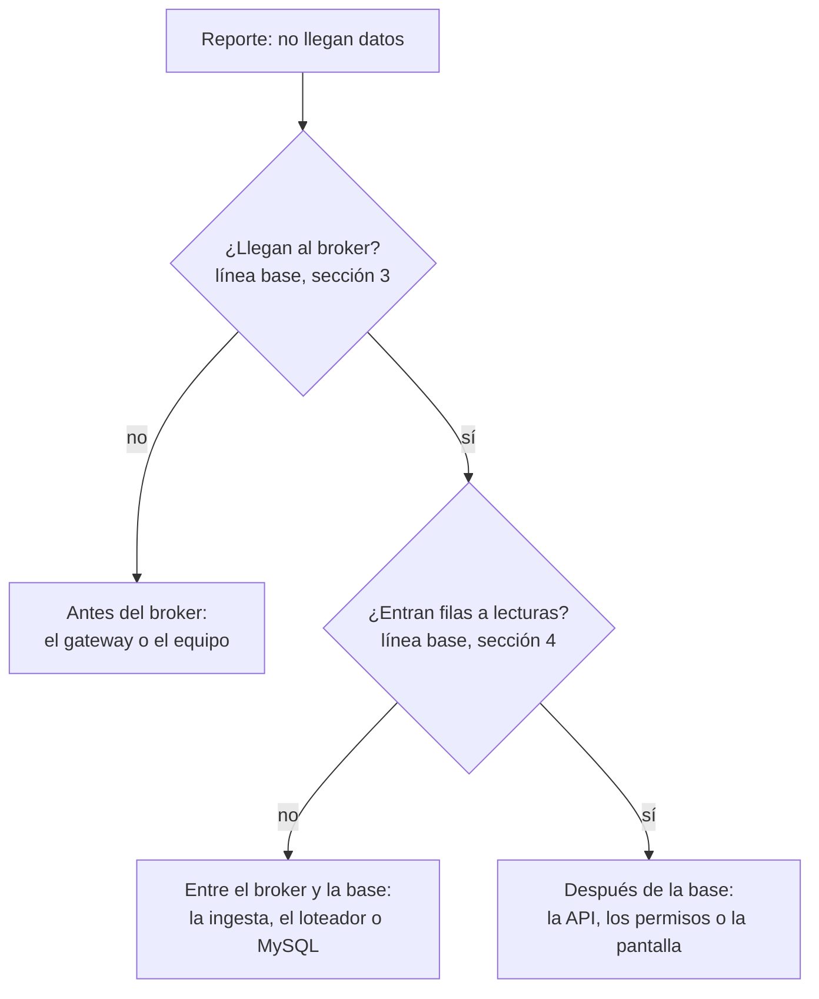

# Simulacros: ¿qué fallas practiqué y cómo las encontré?

Un simulacro es una falla real y reversible que el agente aplica en el laboratorio sin decirte cuál. Tú la diagnosticas con el método de esta página, como si te llamaran desde terreno. Es lo mismo que arrancar el grupo de emergencia cada semana: que la primera caída no te toque en producción, con un cliente esperando.

**Qué hay en esta carpeta**
- `README.md`, esta página: las reglas, el método, el protocolo, la ficha y la tabla de resultados.
- `linea-base.md`: cómo se ve el sistema sano, con el comando que mide cada cifra.
- Una ficha por simulacro: `AAAA-MM-DD-nombre.md`.
- `guion-del-agente.md`: las fallas y sus respuestas. Es para el agente: no lo abras.

## Reglas

| Hacer | No hacer | Por qué |
|---|---|---|
| Anotar la hora de cada observación y de cada acción | Reconstruir la cronología de memoria al día siguiente | La secuencia exacta suele ser la que explica la causa |
| Mirar antes de tocar: logs, contadores y estado | Reiniciar todo "por si acaso" | Reiniciar borra la evidencia y, si vuelve a fallar, no sabes por qué |
| Cambiar una sola cosa y volver a medir | Cambiar tres cosas a la vez | No sabrás cuál lo arregló ni cuál lo empeoró |
| Decir "todavía no sé" y qué vas a revisar | Dar una causa sin evidencia | Un diagnóstico falso manda a todos en la dirección equivocada |

## El método, siempre en este orden

1. **Qué ve exactamente quien reporta, y desde cuándo.** Anota la hora en UTC, como los logs y la base. El reporte llega con la hora de Chile continental: UTC−3 en verano y UTC−4 en invierno.
2. **El alcance:** un equipo, un sitio o todo.
3. **Qué cambió:** un despliegue, una clave, una configuración o un corte.
4. **Sigue el dato por su camino:** equipo → gateway → broker → ingesta → base → API → pantalla. Parte por la mitad y descarta una mitad cada vez.
5. **Una hipótesis a la vez,** y cada una se confirma con una evidencia: un log, una consulta o un contador.
6. **Mitiga, comprueba que volvió** y recién entonces busca la causa raíz.

Al final, responde siempre una pregunta más: **¿se perdieron datos?** Cuáles, entre qué horas, y si vuelven solos (un buffer que drena) o no vuelven.

### Partir por la mitad



**Cómo leerlo.** Cada rombo es una medición que corta el camino en dos. La primera mira el broker, que está en la mitad: si los mensajes no llegan, todo lo que viene después queda descartado de una vez, y al revés. La segunda corta la mitad que quedó. Con dos mediciones, el problema queda en un tramo de dos o tres piezas.

**La idea.** No se revisa pieza por pieza desde el equipo: se mide en la mitad. Es lo que haces con un lazo de 4-20 mA que no llega al PLC: mides la corriente en la bornera del tablero, y eso te dice si la falla está hacia el transmisor o hacia la tarjeta.

### Dónde mirar en cada tramo

| Tramo | Pregunta | Dónde mirar | Sano |
|---|---|---|---|
| Equipo | ¿El equipo entrega valores? | `docker compose logs simulador --tail 4` | Cada equipo `en marcha`, cerca de 1.500 rpm y sin alarmas |
| Gateway | ¿Está conectado y lee? | Su estado retenido (línea base, sección 3) y `docker compose logs gateway --since 30m` | `gw-norte` en `online`, sin avisos ni errores |
| Broker | ¿Llegan los mensajes? | Línea base, sección 3 | 12 por minuto de MTR-01 y 30 de MTR-02 |
| Ingesta | ¿La API los acepta? | `/api/metricas` dos veces, con un minuto de diferencia (línea base, sección 2) | `rechazos` vacío y `pendientes` cerca de 0 |
| Base | ¿Entran filas? | Línea base, sección 4 | 84 por minuto de MTR-01 y 210 de MTR-02 |
| API | ¿Responde y está lista? | `/api/listo` (línea base, sección 2) | `listo` |
| Pantalla | ¿El navegador recibe? | El dashboard, en DevTools: Network → WS → Messages | Sin medir todavía |

**Ruido conocido.** Aunque todo esté bien, aparecen los 8 equipos sin datos (de MTR-03 a MTR-10) y los 11 eventos de cada arranque de Docker. El detalle está en la línea base, sección 6. No lo persigas, pero si cambia, ya no es ruido: otro equipo en silencio, o un error sin un arranque de por medio.

## El protocolo

El detalle de lo que hace el agente está en `AGENTS.md`, sección "Simulacros". Desde tu lado:

| Escribes | Qué pasa |
|---|---|
| `simulacro` | El agente comprueba que el sistema esté sano y te pide una sola confirmación, sin decir qué falla. La aplica, anota la hora y te da solo el reporte, como lo diría quien llama, con la hora de Chile. |
| Una pregunta de sintaxis | Te responde sin orientarte hacia la causa. |
| `pista` | Una ayuda, de menor a mayor. Hasta tres. |
| `me rindo` | La explicación completa. |
| `resuelto: <causa>` | Evalúa la causa, la evidencia y qué pasó con los datos. Después revierte la falla, comprueba que el sistema volvió a estar sano y prepara la ficha. El diagnóstico lo escribes tú. |

**Antes de empezar**
- Git Bash abierto en la raíz del repositorio, con el `.env` cargado: `set -a; source .env; set +a`.
- `linea-base.md` a mano.
- Dónde anotar horas: un papel o un archivo de texto. La ficha se arma al final con esas notas.

**Tiempo hasta el diagnóstico:** desde la hora del reporte hasta tu `resuelto:` con la causa correcta.

## La ficha

Cada simulacro deja `docs/simulacros/AAAA-MM-DD-nombre.md`, donde el nombre dice la falla en dos o tres palabras. El agente la prepara y tú escribes el diagnóstico:

```markdown
# AAAA-MM-DD · La falla, en una frase

## Reporte
Lo que dijo quien llamó, con su hora.

## Cronología
| Hora (UTC) | Qué vi o qué hice | Evidencia |
|---|---|---|

## Diagnóstico
- **Causa:**
- **Mitigación:**
- **Cómo se prevendría:**

## ¿Se perdieron datos?
Cuáles, entre qué horas y por qué.

## Lo que le faltó al sistema
Lo que habría hecho más fácil encontrarla. Es la lista de deseos de la Fase 23.
```

Si no existía un procedimiento para esa falla, se agrega a `docs/RUNBOOK.md`.

## Resultados

| N.º | Fecha | Ficha | Tiempo hasta el diagnóstico | Pistas | ¿Te rendiste? | ¿Se perdieron datos? |
|---|---|---|---|---|---|---|

Todavía no hay simulacros.

**La meta de la fase** (PLAN-2, Fase 15)
- Cinco fichas con su cronología, y al menos una de un escenario donde se perdieron datos.
- Al menos dos procedimientos nuevos en `RUNBOOK.md`.
- Un tiempo que baja en esta tabla.
- Para dominarla: tres simulacros seguidos sin pistas, en menos de 15 minutos cada uno.
